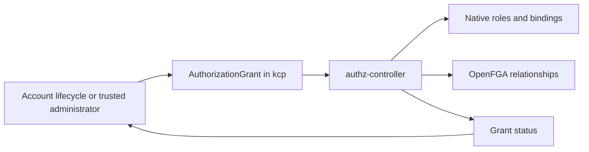

# Authorization modularization PoC walkthrough

The PoC asks: **can account lifecycle code describe the access it needs without
knowing whether OpenFGA or native RBAC will enforce it?**

It introduces a small authorization intent API, runs its reconciliation in a
separate process, and checks access through real kcp requests. IAM, invitations
and UI workflows are outside this experiment. Each profile uses a fresh
deployment; moving existing permissions between backends is outside its scope.

## 1. The main change

Previously, account initialization and termination used OpenFGA concepts directly:
they created or removed relationship tuples and dealt with stores. Replacing the
authorization webhook alone would leave those lifecycle operations coupled to
OpenFGA.

With the PoC enabled, lifecycle code writes an `AuthorizationGrant` instead. The
grant describes a user, an account, a role and whether the grant is active. A
separate `authz-controller` translates it into the selected backend.



Each deployment selects one backend. The diagram shows the two implementations
available for comparison.

Trusted administrators and the core initializer write grant intent. The
authorization controller owns its backend projection and status. Intent profiles
omit the legacy authorization writers so two implementations do not compete to
manage the same permissions.

Here, **projection** means translating a stored grant into the permissions the
backend understands. **Reconciliation** means repeatedly checking that those
permissions match the grant, including after retries or revocation.

## 2. What is a boundary here?

A boundary is the agreement between components: what one component can request,
what another component must do, and how they report the result. It lets us change
the implementation on one side without rewriting its callers.

| Boundary | Agreement in this PoC |
|---|---|
| Account lifecycle → authorization module | Write `AuthorizationGrant`; observe its reconciliation status. Lifecycle code does not choose FGA tuples or RBAC bindings. |
| API access → authorization decision | Send an ordinary request to kcp. In the FGA profile, kcp calls the authorization webhook using `SubjectAccessReview`. |
| Provider → API consumer | `APIExportPolicy` describes which workspaces may bind a provider's API. User permissions on resources are a separate decision. |

For example, “reader may read this account's contents” is intent. The name of an
FGA relation or a generated ClusterRoleBinding is an implementation detail owned
by the authorization module.

A boundary is more than a folder or a deployment. The PoC separates processes
and responsibilities, but still uses the security-operator binary and Go module.
It has two explicit backend implementations, rather than a general plugin system.

## 3. Which KRM contracts exist?

Storing intent as a KRM object makes it available
for inspection, retries and reconciliation independently of the backend.

The PoC adds **one new resource kind**, `AuthorizationGrant`. It also gives an
existing resource, `APIExportPolicy`, a limited backend-independent implementation.
It does not add separate Role, Permission or Assignment custom resources.

### AuthorizationGrant: who should have access?

Example: a trusted administrator creates this object in `root:orgs`, alongside
the `Account` named `org-a`. Replace the UID with that Account's actual UID.

```yaml
apiVersion: core.platform-mesh.io/v1alpha1
kind: AuthorizationGrant
metadata:
  name: example-reader
spec:
  accountRef:
    name: org-a
    uid: REPLACE_WITH_ACCOUNT_UID
  subject:
    kind: User
    name: reader
  roleRef: account-reader
  propagation: Local
  state: Active
```

| Field | Meaning and reason |
|---|---|
| `accountRef.name` and `accountRef.uid` | Identify the Account in the grant's workspace. The UID prevents an old grant from authorizing a new Account that reuses its name. |
| `subject` | A canonical authenticated username. The PoC supports `User`; identity mapping from OIDC claims or invitation emails is not implemented here. |
| `roleRef` | Either `account-reader` or `account-editor`. These are fixed names defined in code, rather than references to Role custom resources. |
| `propagation` | `Local` applies to this account workspace. `Descendants` requests access to this workspace and its descendants. Backend support differs. |
| `state` | `Active` requests access; `Revoked` requests its removal. |

The account reference, subject, role and propagation are immutable. Change
`state` to revoke a grant; create another grant to request a different role or
subject. The schema validates those rules.

The resource is cluster-scoped within its kcp workspace: it has no Kubernetes
namespace, and it is not a global grant across all platform workspaces.

The grant controls **contents of the generated account workspace**. It does not
give access to the Account object stored in its parent workspace. Reading an
immediate child Account object inside an authorized workspace also does not give
access to that child's workspace.

The role catalog is deliberately small:

| Role | Resource permissions |
|---|---|
| `account-reader` | Read AccountInfo, immediate child Account objects and HTTPBins using get/list/watch. |
| `account-editor` | Reader permissions plus create/update/patch/delete HTTPBins. |

The native rules also include workspace entry and self access reviews. Neither
role grants Account mutation, permission management, RBAC management or secrets.
An editor is not an account administrator. HTTPBin is the example provider API
used to test a meaningful read/write distinction.

The controller writes status, for example:

```yaml
status:
  workspace: RESOLVED_LOGICAL_CLUSTER_ID
  observedGeneration: 1
  conditions:
    - type: Reconciled
      status: "True"
      reason: Reconciled
      observedGeneration: 1
      lastTransitionTime: "2026-11-10T14:04:04Z"
```

The resolved workspace records where cleanup must happen. A matching generation
and `Reconciled=True` mean the controller applied the current requested state.
For a revoked grant, successful reconciliation means its permissions were
removed. It does not mean the user is allowed, or that every access cache has
converged. The validation runner checks effective access separately.

Unsupported inheritance in RBAC produces `Reconciled=False` with reason
`UnsupportedCapability`. It does not silently convert the request into a local
grant.

### APIExportPolicy: which workspace may bind an API?

This existing kind is reused. For example:

```yaml
apiVersion: core.platform-mesh.io/v1alpha1
kind: APIExportPolicy
metadata:
  name: orchestrate.platform-mesh.io
spec:
  apiExportRef:
    name: orchestrate.platform-mesh.io
    clusterPath: root:providers:httpbin-provider
  allowPathExpressions:
    - ":root:orgs:org-a"
```

The PoC supports exact account workspace paths under `root:orgs`. Wildcard path
expressions are rejected. The supplied [provider policy](provider-policy.yaml)
lists all four fixture workspaces explicitly.

This permission allows a workspace to bind the HTTPBin API. An APIBinding makes
the API available there; an AuthorizationGrant then controls a user's operations
on its resources. Removing binding eligibility does not remove existing bindings
or revoke user grants. Provider maximal permission policies remain an additional
kcp restriction; their behavior requires the separate validation described below.

## 4. Follow an account through the system

1. **An administrator creates an Account.** Account/workspace provisioning still
   uses the existing platform controllers.
2. **The initializer publishes creator intent.** With
   `--authorization-intent-enabled`, it creates a deterministic
   `bootstrap-<Account UID>` grant for `Account.spec.creator`: local editor access.
3. **The authorization controller resolves the target.** It checks the Account
   UID, finds the generated workspace, and records the target before writing
   backend permissions. It also installs cleanup ownership and a finalizer.
4. **The selected backend applies the grant.** The controller reports the result
   in status. The initializer waits for the current grant generation to reconcile.
5. **The user sends requests to kcp.** kcp evaluates the configured authorization
   chain; the user never calls the projection controller to access a resource.
6. **Revocation changes intent.** The controller removes that grant's permissions.
   Account termination requests revocation and waits for cleanup to reconcile.

Creator grants are created once. Restarting an initializer does not reactivate a
revoked creator grant. Bootstrap grants are retained during the Account's lifetime;
use `state: Revoked` to remove creator access. Other grant deletion uses the
finalizer to finish backend cleanup before the object disappears.

If projection is unavailable, a revocation can remain pending while previously
projected access still exists. Separating the processes makes this delay visible
and testable; it does not make asynchronous revocation instantaneous.

## 5. What each backend does

| | Native RBAC | OpenFGA |
|---|---|---|
| Stored projection | A ClusterRole and ClusterRoleBinding per grant UID, in the target workspace. | A grant assignment and permission relationship per grant UID, in the dedicated `platform-mesh-authz-poc` store. |
| Request checks | kcp evaluates native RBAC. No FGA authorization webhook is deployed or registered. | kcp calls the separately deployed webhook, which maps the requested operation to a role check in FGA. |
| Overlapping grants | Each binding has independent ownership. | Each grant has its own relationship object. |
| Local propagation | Supported. | Supported. |
| Descendant propagation | Explicitly unsupported by this adapter. | Implemented using parent workspace relationships and explicit descendant roles. |

Independent grant ownership matters: if two grants give reader access, revoking
one must leave the other's access intact. Both adapters implement that rule.

The FGA profile uses two processes from the same binary:

- `authz --projection-only` runs as `authz-controller` and writes backend state.
- `authz --checks-only` runs as `rebac-authz-webhook` and serves permission checks.

That separation lets an experiment interrupt projection while existing
permissions can still be checked. For recognized requests, an FGA check error
returns a denial. Requests outside the PoC catalog receive no opinion from this
webhook and continue through kcp's configured chain.

## 6. Main code changes and why

Paths below are relative to the monorepo root.

| Code | Change and purpose |
|---|---|
| [authorizationgrant_types.go](../../../apis/core/v1alpha1/authorizationgrant_types.go) | Adds the shared intent type, validation and status. Generated deepcopy, CRD and APIResourceSchema files make the type usable through kcp. |
| [authorization_intent.go](../../../operators/security-operator/internal/subroutine/authorization_intent.go) and the org/account lifecycle controllers | Replace direct tuple operations with grant creation and revocation when the PoC flag is enabled. |
| Security-operator initializer and terminator commands | Avoid creating FGA connections and store caches in intent mode. Account lifecycle can run with the RBAC backend. |
| [cmd/authz.go](../../../operators/security-operator/cmd/authz.go) and [reconcile.go](../../../operators/security-operator/pkg/authz/reconcile.go) | Add an independent process that polls explicitly configured parent workspaces, resolves scope, projects permissions and writes status. |
| [rbac.go](../../../operators/security-operator/pkg/authz/rbac.go), [fga.go](../../../operators/security-operator/pkg/authz/fga.go), [webhook.go](../../../operators/security-operator/pkg/authz/webhook.go) | Implement the role catalog, backend translations and FGA request checks. Engine-specific details stay here. |
| [policy.go](../../../operators/security-operator/pkg/authz/policy.go) | Projects the exact-path subset of APIExportPolicy into native bind permissions or FGA relationships. |
| [profiles.Tiltfile](profiles.Tiltfile) and the shared Tiltfiles | Assemble legacy, FGA-intent and RBAC-intent deployments. Intent profiles omit legacy authorization writers; RBAC also omits the engine and webhook. |
| Platform-mesh-operator deployment and wait subroutines | Add opt-in omission of FGA webhook certificates/registration dependencies, and skip the authentication audience wait when the headless composition disables its initializer. |
| [validation.go](../../../operators/security-operator/pkg/authz/validation.go), fixtures and evidence scripts | Exercise real API access and reviews, and retain reproducible reports with runtime configuration and image information. |

The original deployment remains the default when the PoC flags/profile are not
selected. Health endpoints and explicit container probes are needed for these new
processes to run reliably; they report process initialization, while grants report
permission projection.

## 7. What exactly do we test and compare?

There are three profiles:

| Profile | Purpose |
|---|---|
| `authz-baseline` | Legacy authorization writers and webhook in the same headless setup. Its two cases check creator access and denial for an unassigned user. |
| `authz-openfga` | New grant intent, independent projection and the experimental FGA model/webhook. |
| `authz-rbac` | The same grant intent projected into native RBAC, without OpenFGA or its webhook. |

The two intent profiles share ten scenarios. Two additional scenarios deliberately
have different expectations for descendant propagation:

| Scenario | OpenFGA expectation | RBAC expectation |
|---|---|---|
| Local reader grant | Read AccountInfo allowed. | Same. |
| Reader HTTPBin create | Denied. | Same. |
| Local editor grant | Read AccountInfo allowed. | Same. |
| Editor HTTPBin create | Allowed. | Same. |
| Grant management denial | Editor cannot read a grant in the tested target workspace. | Same. |
| Sibling isolation | Local grant on org-a gives no access to org-b. | Same. |
| Descendant isolation | Local grant on org-a gives no access to account-a. | Same. |
| Overlapping reader grant | A second grant also supplies access. | Same. |
| Revoke first reader grant | Access remains through the second grant. | Same. |
| Revoke last reader grant | Access is denied. | Same. |
| Descendants grant | Grant reconciles; access to org-a is allowed. | Grant is rejected as unsupported; access stays denied. |
| Access below that grant | Access to account-a is allowed. | Access to account-a is denied. |

`task authz-poc:demo` waits for the actual HTTPBin schema, provisions the fixture
accounts and API bindings, collects runtime evidence, resets runner-owned grants,
then executes the profile's [scenario file](cases-rbac.json).

The administrator changes grants. Resource probes use synthetic ordinary users
with `system:authenticated`, without `system:masters`. Each case compares:

1. **An actual API operation:** usually reading AccountInfo, or a server-side
   dry-run HTTPBin create. Dry run exercises API authorization without creating a
   workload.
2. **An authorization review for the same operation and identity:** normally
   SelfSubjectAccessReview. If that user cannot submit it, the administrator
   submits an exact-subject SubjectAccessReview in the same target workspace;
   the report records this fallback.

An expected denial must be an authorization denial. A missing API, transport
failure or review evaluation error fails the scenario.

Reports classify cases as `preserved` (matches the declared expectation),
`unsupported` (explicit capability rejection matches the expectation), or
`defect` (a mismatch or execution failure). `preserved` alone is not proof of
legacy parity: the baseline has only two checks, and the new FGA model is a
separate experiment. Compare recorded runs and their inputs before claiming
equivalence. The seconds column includes reconciliation and verification; it is
not a request-latency benchmark.

Unit tests additionally cover stale Account UIDs, retry after an uncertain FGA
write/delete outcome, cleanup ownership, role boundaries, backend error denial,
and preserving creator-grant revocation across initialization.

Separate experiment scripts exercise FGA outage, projection interruption, replay
into an empty FGA store, and Account deletion/recreation. They are validation
tools retained for the PoC, with no successful live results assumed. Provider
maximal permission policy restrictions and binding eligibility revocation require
the additional procedures in [README.md](README.md).

## 8. What is breaking, and what remains coupled?

The new API is additive and the lifecycle flag defaults to off. Existing Account
or AccountInfo schemas were not changed by this PoC. **Selecting the PoC changes
authorization semantics and deployment composition**, so it is intended for fresh
clusters rather than an upgrade of an existing installation.

| Change when selecting an intent profile | Compatibility consequence |
|---|---|
| Creator access becomes a local `account-editor` grant. | It is narrower than legacy ownership/admin behavior. It does not grant Account creation, permission administration or implicit descendant access. |
| Inheritance must be requested explicitly. | Existing assumptions that parent access automatically reaches child workspaces need to change. The current RBAC adapter cannot satisfy Descendants intent. |
| Fixed roles and canonical User subjects form the shared subset. | Arbitrary policies, group/service-account grants, expiry and identity-provider mappings need further contracts. |
| Only exact APIExportPolicy paths are projected. | Wildcard policies from a broader implementation cannot be used unchanged. |
| The PoC uses a dedicated FGA store/model or new native bindings. | Existing FGA tuples are not imported. Backend replacement for a live installation needs migration work. |
| IAM, invitations and UI services are omitted. | This composition demonstrates core behavior rather than compatibility with those workflows. |

What we have decoupled is the **tested account authorization lifecycle**: it
publishes intent instead of writing FGA tuples, and can wait for backend-neutral
status. The native profile also removes the running FGA engine, authorization
webhook and their installation dependencies.

IAM's direct engine access, search/access-list queries, invitation integration and
other legacy writers are not converted by this PoC; they are excluded from its
intent profiles. There is no general authorization query API or dynamic role
catalog yet. The Go module still contains FGA dependencies. The new grant API
still assumes Platform Mesh Accounts and kcp workspaces.

This also makes two deliberate choices beyond the original RFC/ADR sketch:
reconciliation runs outside IAM, and even the native profile projects the shared
AuthorizationGrant into RBAC. Using native bindings directly as the intent would
avoid that projection, but would be a different contract to evaluate.